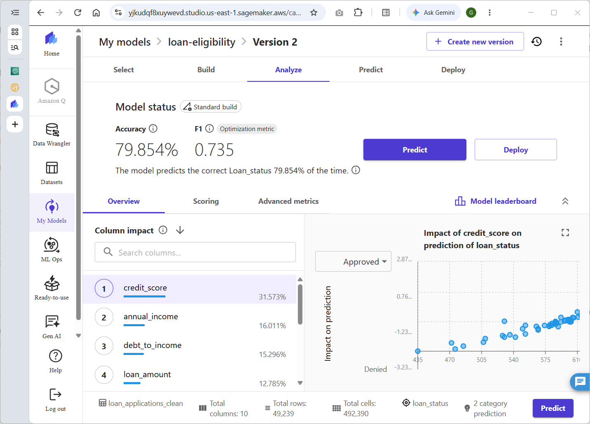

# Loan Eligibility Prediction with Amazon SageMaker Canvas

An end-to-end machine learning project: messy raw data → no-code data preparation
and feature engineering → automated model training → real-time endpoint → REST API
that another application can call.

Built to learn the ML lifecycle on AWS from a cloud/DevOps background.


## Highlights

- **Realistic data cleaning:** currency strings, `85k` shorthands, inconsistent categories, invalid values, missing values, duplicate rows, and a messy target column.
- **Feature engineering:** a derived `debt_to_income` ratio created in the data flow.
- **No training-serving skew:** the custom transforms pasted into Canvas are stored as files in this repo, and the production code executes those **same files** before calling the endpoint.
- **Production path:** real-time endpoint, Lambda + API Gateway integration, IAM least-privilege policy, monitoring and cleanup steps.

## Dataset

`data/loan_applications_raw.csv`: 50,000 rows (including ~500 duplicates), 10 columns, all stored as raw strings.

| Column | Description | Raw examples |
|---|---|---|
| `applicant_id` | Application ID (dropped before training) | `APP-0033554` |
| `age` | Applicant age | `34`, `34 years`, blank, `230` |
| `employment_status` | Employment type | `Salaried`, `self_employed`, `Contractor` |
| `annual_income` | Yearly income | `$85,000`, `85k`, `USD 85,000.00` |
| `credit_score` | Credit score (300–850) | `720`, `720.0`, `Unknown` |
| `existing_debt` | Current outstanding debt | `$12,500`, `12.5k`, `none` |
| `loan_amount` | Requested amount | `$20,000`, `20K` |
| `employment_length` | Time at current job | `5 years`, `10+ years`, `< 1 year`, `8 months` |
| `loan_purpose` | Reason for the loan | `Home Improvement`, `home_improvement`, `Auto` |
| `loan_status` | **Target**: Approved / Denied | `Approved`, `APPROVED`, `Y`, `Rejected`, `N` |

After cleaning: about 49,200 rows, roughly 63% Approved / 37% Denied.

> **Synthetic data.** Outcomes were generated from a hidden scoring rule plus
> random noise (`scripts/generate_dataset.py`). The project demonstrates the
> workflow; the model is not suitable for real lending decisions. Protected
> attributes (gender, race, etc.) were intentionally left out.

Regenerate the data with `python scripts/generate_dataset.py --seed 42`.

## Project structure

```
├── data/loan_applications_raw.csv     # raw, messy training data
├── scripts/generate_dataset.py        # reproducible synthetic data generator
├── canvas_transforms/
│   ├── 01_clean_columns.py            # pasted into Canvas as a custom transform
│   └── 02_add_debt_to_income.py       # pasted into Canvas as a custom transform
├── app/
│   ├── preprocess.py                  # runs the Canvas transforms at prediction time
│   ├── invoke_endpoint.py             # CLI test client
│   ├── lambda_function.py             # API handler for other applications
│   ├── iam_invoke_policy.json         # least-privilege invoke policy
│   └── sample_application.json        # example raw applications
├── docs/                              # step-by-step guide
├── images/architecture.svg            # diagram used in this README
└── screenshots/                       # Canvas screenshots used in docs/
```

## Step-by-step guide

1. [Setup: AWS, SageMaker domain, Canvas](docs/01-setup.md)
2. [Data preparation and feature engineering](docs/02-data-preparation.md)
3. [Build and evaluate the model](docs/03-build-and-evaluate.md)
4. [Deploy, integrate, monitor, clean up](docs/04-deploy-and-integrate.md)

Total time: about 2–3 hours with a Quick build.

## Results

From the Canvas Analyze tab (Version 1 = Quick build, Version 2 = Standard build).

| Metric | Quick build | Standard build |
|---|---|---|
| Accuracy | 78.8% | 79.9% |
| F1 (Approved) | 0.728 | 0.735 |
| AUC | | |
| Top 3 features | credit_score, annual_income, loan_amount | credit_score, annual_income, debt_to_income |

Local sanity check on the same cleaned data (gradient boosting): ~79% accuracy, ~0.86 AUC.
Majority-class baseline: 63%.



## What I learned

*Replace with your own notes. Ideas:*
- What a feature and a label are, and why derived features like debt-to-income matter.
- Why data cleaning took longer than training.
- Training-serving skew, and how sharing transform code avoids it.
- Quick vs Standard builds, and reading precision/recall for a lending use case.
- Cost control: Canvas session hours and always-on endpoints.

## Cost notes

- Canvas bills per session hour while you're logged in. **Log out** when done.
- The real-time endpoint bills per instance-hour until it's **deleted**.
- Check current prices on the AWS pricing pages and set a budget alert before you start.

## Tech

Amazon SageMaker Canvas, SageMaker Data Wrangler (in Canvas), SageMaker real-time
inference, AWS Lambda, Amazon API Gateway, IAM, CloudWatch, Python (pandas, boto3).
