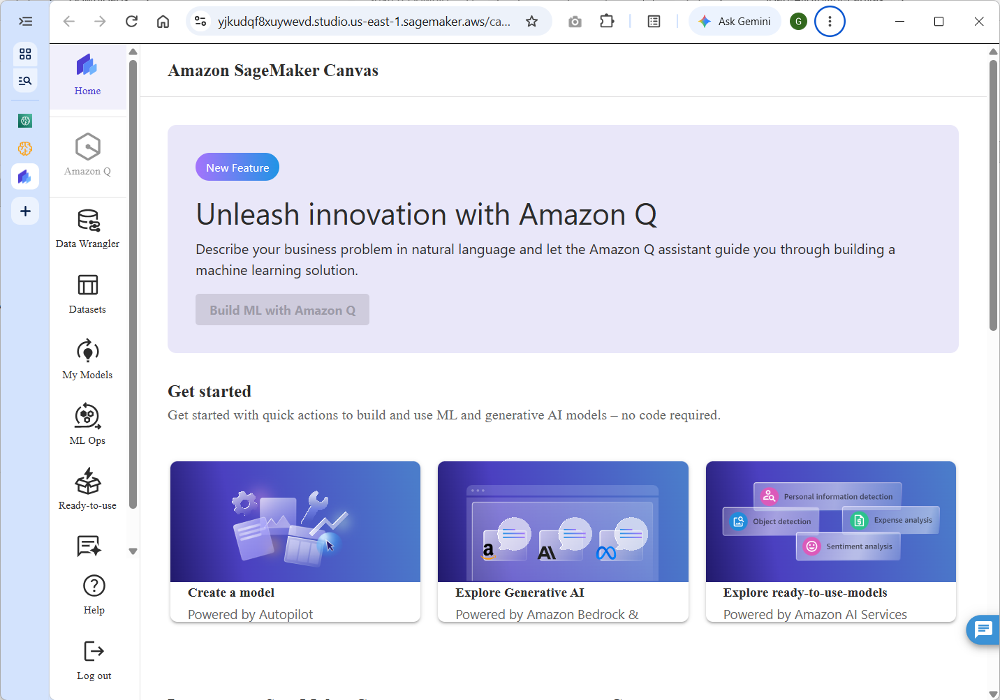

# 1. Setup: AWS account, SageMaker domain and Canvas

**Time:** 15–30 minutes (skip what you already have)

> Console labels change from time to time. If a button name below doesn't match
> exactly, look for the closest equivalent; the flow stays the same.

## 1.1 Protect yourself from surprise bills (do this first)

1. Open **Billing and Cost Management → Budgets → Create budget**.
2. Choose a **monthly cost budget** (for example $25) with an email alert at 80%.

Two things in this project bill **by the hour while they are running**:

| Resource | Billed while… | How to stop it |
|---|---|---|
| Canvas workspace | you are logged in to Canvas | Click **Log out** in Canvas (closing the tab is not enough) |
| Real-time endpoint | the endpoint exists | Delete the deployment (see `04-deploy-and-integrate.md`) |

## 1.2 Pick a region

Use one region for everything (Canvas, S3, endpoint, Lambda). Write it down;
you'll need it in `AWS_REGION` later. This guide uses `us-east-1` in examples.

## 1.3 Create a SageMaker AI domain

If you don't already have a domain:

1. Open the **Amazon SageMaker AI** console.
2. Choose **Domains → Create domain → Set up for single user (Quick setup)**.
3. Wait until the domain status is **InService** (a few minutes).

Quick setup creates an IAM execution role with the Canvas permissions attached.

## 1.4 Make sure model deployment is allowed

Direct deployment from Canvas is normally enabled by default. To check:

1. **Domains →** your domain **→ User profiles →** your user.
2. Open the **App Configurations** tab, and in the **Canvas** section choose **Edit**.
3. Under **ML Ops configuration**, confirm **Enable direct deployment of Canvas models** is on.
4. Choose **Submit** if you changed anything.

## 1.5 Launch Canvas

1. From your user profile choose **Launch → Canvas**.
2. The first launch takes a few minutes while the workspace starts.



## 1.6 Clone this repo locally

```bash
git clone https://github.com/<you>/loan-eligibility-canvas.git
cd loan-eligibility-canvas
python -m venv .venv && source .venv/bin/activate
pip install -r requirements.txt
```

You'll upload `data/loan_applications_raw.csv` in the next step.
