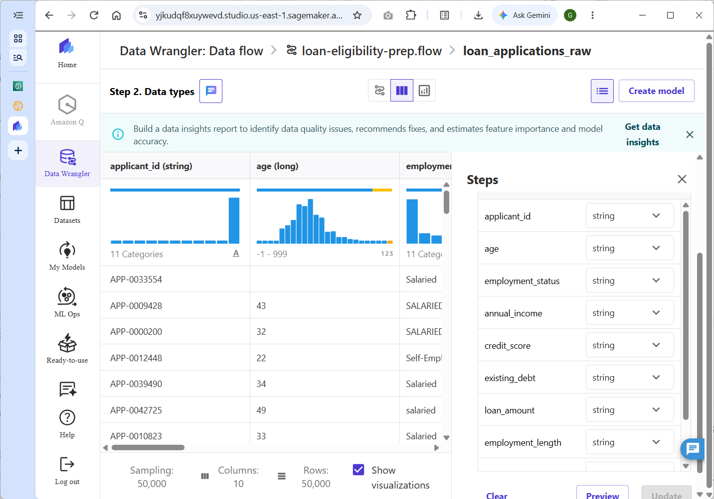
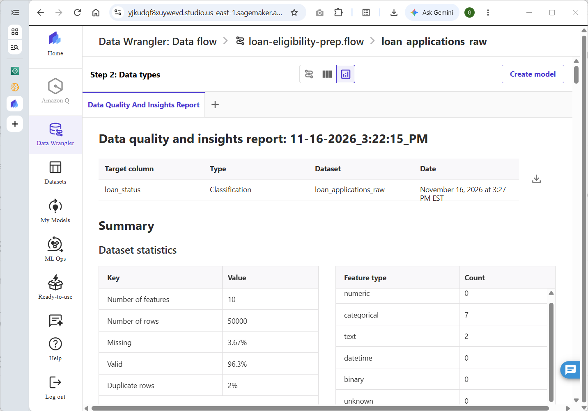
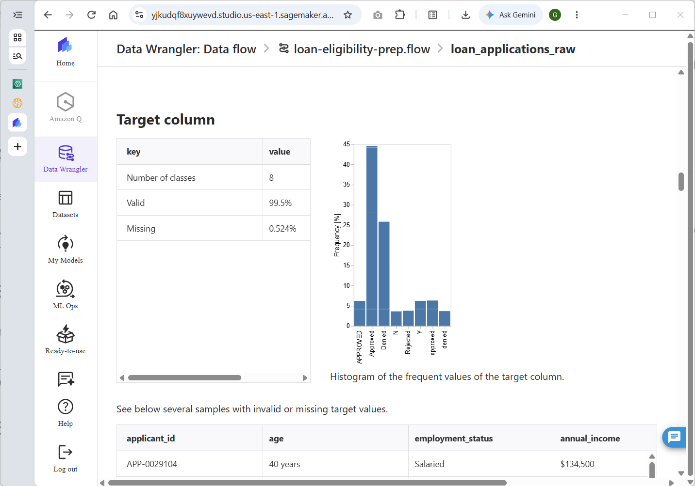
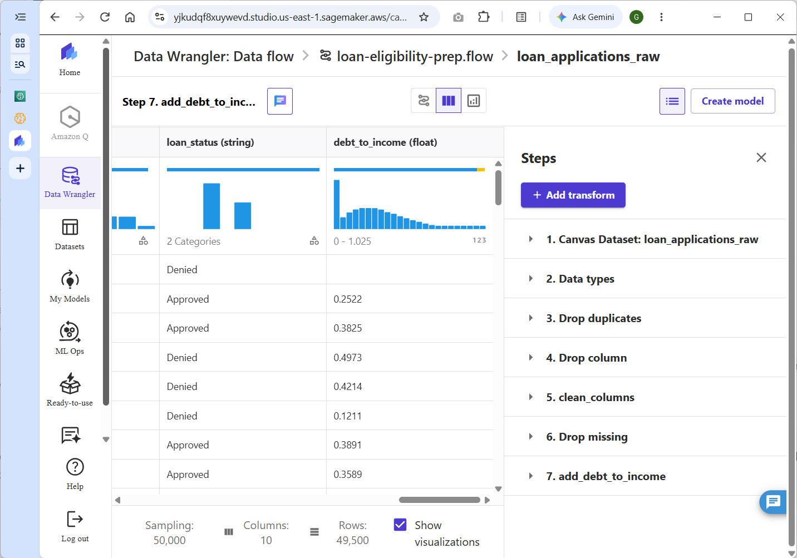
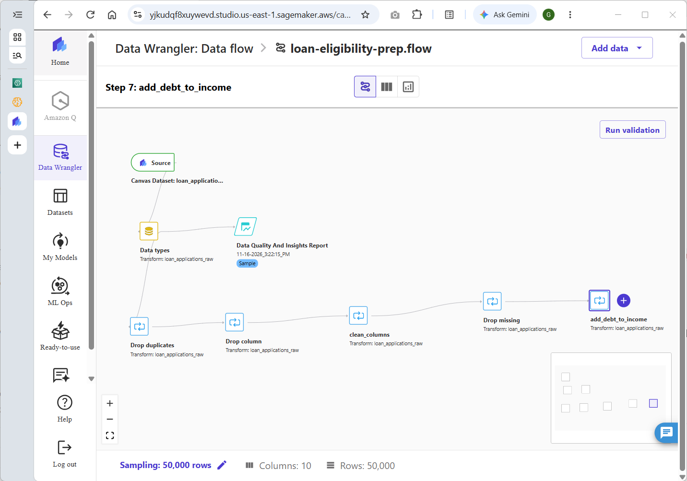
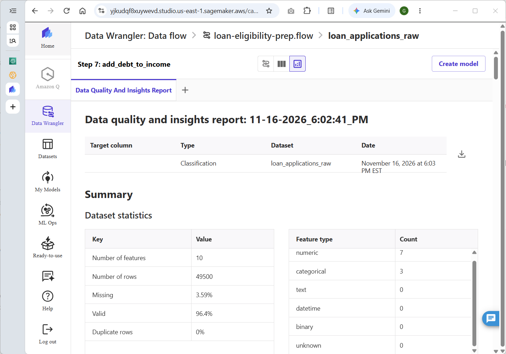
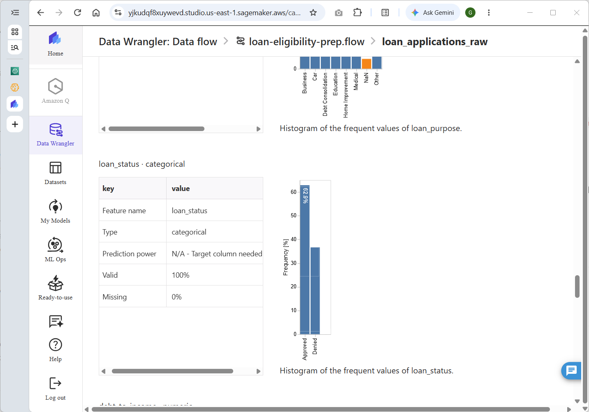

# 2. Data preparation in Canvas (Data Wrangler)

**Time:** 30–60 minutes the first time

The raw file looks like a real export from an operational system: the same
value is written in many different ways, some values are missing or invalid,
and some rows are duplicated. The goal of this step is to turn it into a
clean, typed table the model can learn from.

## 2.1 What's wrong with the raw data

| Column | Examples of mess | Fix |
|---|---|---|
| `applicant_id` | `APP-0033554` | Drop. An ID has no predictive meaning and can cause overfitting |
| (all) | ~500 exact duplicate rows | Drop duplicates |
| `age` | `34`, `34 years`, ` 34 `, blank, `230`, `-1` | Extract number; invalid → missing |
| `employment_status` | `Salaried`, `SALARIED`, `Salaried `, `self_employed`, `Contractor` | Normalize to 5 categories |
| `annual_income` | `$85,000`, `85000`, `85k`, `USD 85,000.00`, blank | Parse to a number |
| `credit_score` | `720`, `720.0`, `Unknown`, `N/A`, `9999` | Parse; outside 300–850 → missing |
| `existing_debt` | `$12,500`, `12.5k`, `none`, `0` | Parse; `none` → 0 |
| `loan_amount` | `$20,000`, `20K`, `20,000.00` | Parse to a number |
| `employment_length` | `5 years`, `5 yrs`, `10+ years`, `< 1 year`, `8 months`, `N/A` | Convert to years |
| `loan_purpose` | `Home Improvement`, `home_improvement`, `Auto`, `auto loan` | Normalize to 7 categories |
| `loan_status` (target) | `Approved`, `APPROVED`, `Y`, `Denied`, `Rejected`, `N`, blank | Normalize to `Approved` / `Denied`; drop rows with no label |

## 2.2 Import the dataset

1. In Canvas, choose **Datasets → Import data → Tabular**.
2. Choose **Local upload** and select `data/loan_applications_raw.csv`.
3. Preview, name the dataset `loan_applications_raw`, and import.
4. Wait until the status is **Ready**.

## 2.3 Create a data flow

1. In the left navigation choose **Data Wrangler**.
2. Create a new data flow and import the `loan_applications_raw` Canvas dataset
   (you can also start the flow from the dataset's page).
3. Rename the flow to `loan-eligibility-prep`.

The flow starts with a **Data types** step that Canvas adds automatically.

## 2.4 Set every column to String

Open the **Data types** step and set **all 10 columns to `String`**, then update.

*Why:* if Canvas guesses that `credit_score` is a number, values like `Unknown`
get silently turned into nulls before you've decided how to handle them. Keeping
everything as text lets the cleaning step make those decisions explicitly.

## 2.5 Look at the data before changing it

On the flow, choose **+ → Get data insights** (data quality and insights report)
with `loan_status` as the target, problem type **Classification**.

The "before" report: 50,000 rows, 3.67% missing values, 2% duplicate rows, and
every column detected as categorical or text because nothing is numeric yet.

The target column alone has **8 distinct classes** (`APPROVED`, `Approved`,
`approved`, `Y`, `Denied`, `denied`, `Rejected`, `N`). This is the strongest
"before" evidence for the write-up.

## 2.6 Add the transforms, in this order

For each step: choose **+** after the last step → **Add transform** → pick the
transform → **Preview** → **Add**.

### Step 1 — Drop duplicate rows
**Manage rows → Drop duplicates.** (~500 rows removed.)

Do this *before* dropping `applicant_id`, so only true duplicates are removed.

### Step 2 — Drop the ID column
**Manage columns → Drop column →** `applicant_id`.

### Step 3 — Clean and standardize all columns
**Custom transform → Python (Pandas).** Paste the entire contents of
[`canvas_transforms/01_clean_columns.py`](../canvas_transforms/01_clean_columns.py).
Name the step `clean_columns`.

Preview and spot-check a few rows: `$85,000` should now be `85000.0`,
`10+ years` should be `10.0`, and `Y` should be `Approved`.

### Step 4 — Drop rows with no label
**Handle missing → Drop missing**, column `loan_status`.

A row without a known outcome can't teach the model anything.

### Step 5 — Feature engineering: debt-to-income ratio
**Custom transform → Python (Pandas).** Paste
[`canvas_transforms/02_add_debt_to_income.py`](../canvas_transforms/02_add_debt_to_income.py).
Name the step `add_debt_to_income`.

This creates the new `debt_to_income` column (existing debt ÷ annual income),
the derived feature this project is built around.

### Step 6 — Fix column types (if needed)
Check the type shown for each column. If any of `age`, `annual_income`,
`credit_score`, `existing_debt`, `loan_amount`, `employment_length` or
`debt_to_income` still shows as String, use **Parse column as type → Float**.

### About the remaining missing values
Leave them. Canvas fills missing values automatically when it builds the model,
and the same logic runs inside the deployed model, so the app can send blanks.

## 2.7 (Optional) Re-run the insights report

Run **Get data insights** again on the last step for an "after" picture.

After cleaning: duplicates 0%, 7 numeric columns, 3 categorical columns
(`employment_status`, `loan_purpose`, `loan_status`), and `loan_status` has
exactly two classes, `Approved` and `Denied` (about 63% / 37%).

## 2.8 Export and create the model

1. On the last step choose **⋮ → Create model**.
2. **Dataset name:** `loan_applications_clean`
3. Leave **Process entire dataset** on (otherwise only the preview sample is used).
4. **Model name:** `loan-eligibility`
5. **Problem type:** Predictive analysis / **2 category**
6. **Target column:** `loan_status`
7. Choose **Export and create model**.

Processing the full dataset runs as a background job and can take several minutes.
Expect roughly **49,200 rows** in the clean dataset.

## Why two custom transforms are stored as files

The deployed endpoint does **not** run this data flow. It expects input that is
already cleaned. `app/preprocess.py` executes these same two files before every
prediction, so production data is cleaned with identical code. This prevents
**training-serving skew**, where the model sees data at prediction time that was
prepared differently from its training data.

The training-only steps (drop duplicates, drop ID, drop missing label) don't
need a production equivalent: the app never sends an ID or a label.
