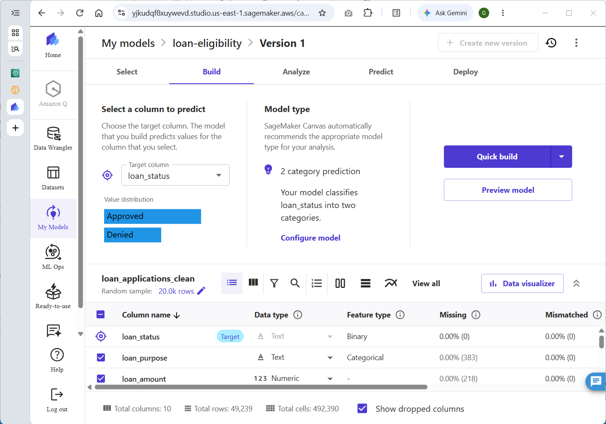
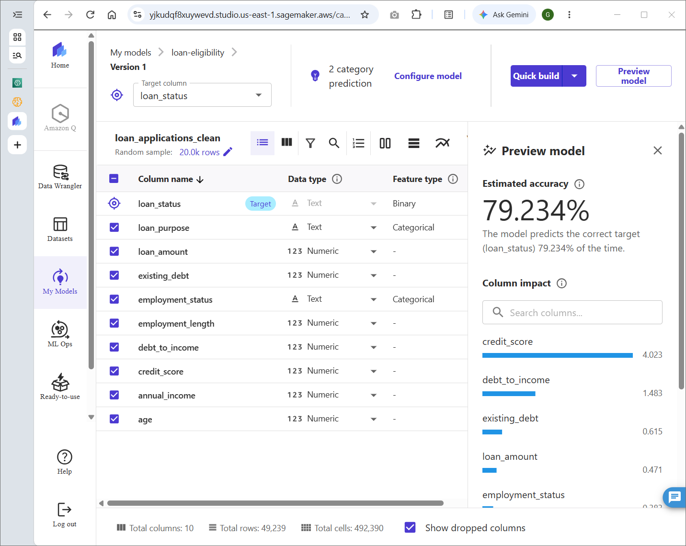
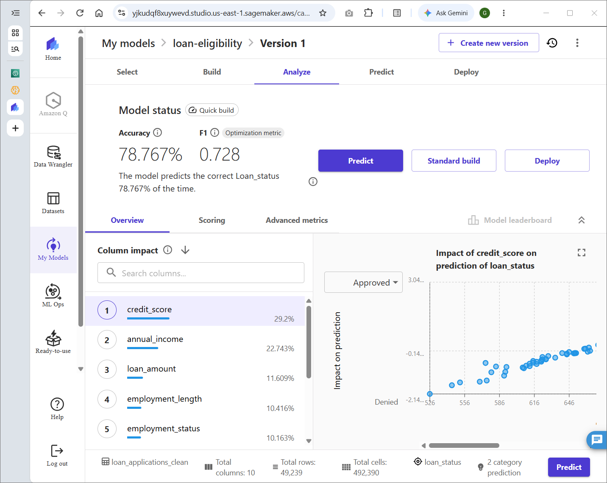
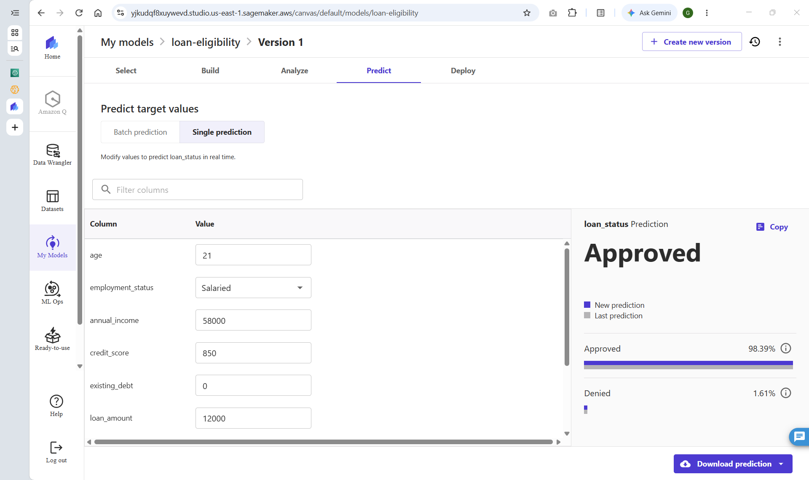
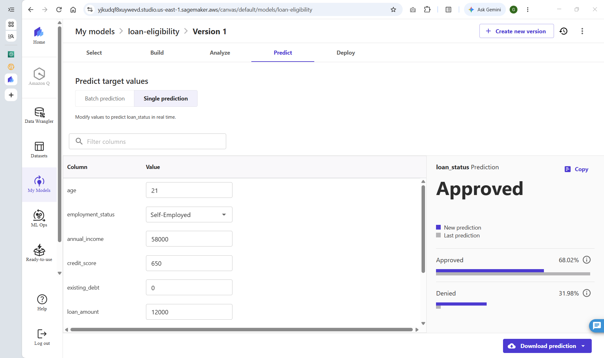
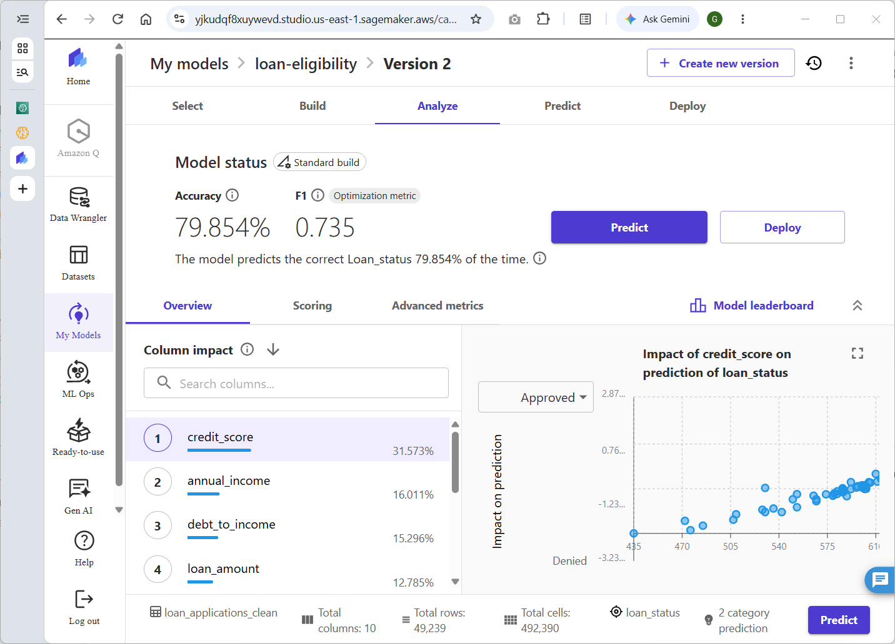

# 3. Build and evaluate the model

**Time:** 2–20 minutes for a Quick build, plus 15–30 minutes to review

## 3.1 Configure the build

You land on the model's **Build** tab after the export.

1. Confirm **Target column** = `loan_status` and model type = **2 category prediction**.
2. In the column list, make sure every feature is selected and `applicant_id`
   is not present (it was dropped in the data flow).
3. Choose **Preview model**. Canvas estimates accuracy and shows which columns
   matter most, without a full build.

The preview estimated **79.2% accuracy** before any build, with `credit_score`
far ahead and `debt_to_income` second in column impact.

## 3.2 Run a Quick build

Choose **Quick build**.

| Option | Time | When to use |
|---|---|---|
| Quick build | about 2–20 min | Learning, iterating, this project |
| Standard build | about 2–4 h | When you want the best accuracy |

Canvas tries many algorithms and keeps the best one.

## 3.3 Read the results (Analyze tab)

**Overview**
- **Accuracy:** share of correct predictions on held-out data.
- **Column impact:** how much each feature influences predictions.
  Expect `credit_score` and `annual_income` at the top. `debt_to_income` ranked
  third in the Standard build (section 3.5). Seeing your engineered feature rank
  highly is a good portfolio talking point.

**Scoring**
- A confusion-matrix style view: how many approvals were predicted as denials and vice versa.

**Advanced metrics**
- **Precision / Recall / F1** for the `Approved` class, and **AUC**.

For a lender, the costly mistake is approving someone who would default
(a false "Approved"). Note in your write-up which error type the model makes
more often.

### What to expect

The labels were generated from a hidden scoring rule plus random noise, so
perfect accuracy is impossible by design. As a sanity check before writing this
guide, a gradient-boosting model trained locally on the same cleaned data scored
about **79% accuracy and 0.86 AUC** (baseline if you always guessed "Approved":
63%). Your Canvas numbers will differ somewhat. Much higher accuracy would be a
sign that something leaked into the features.

Quick build result: **78.8% accuracy, F1 0.728**. Column impact: `credit_score`
29.2%, `annual_income` 22.7%, `loan_amount` 11.6%, `employment_length` 10.4%,
`employment_status` 10.2%.

## 3.4 Try single predictions

On the **Predict** tab choose **Single prediction**. Change the values and watch
the result move:

- Raise `credit_score` from 600 to 780.
- Raise `existing_debt` so `debt_to_income` goes from 0.15 to 0.60.
- Switch `employment_status` to `Unemployed`.

A 21-year-old salaried applicant with a credit score of 850 and no debt:
**Approved, 98.4%**.

Same applicant, self-employed with a credit score of 650: still Approved, but
the confidence drops to **68.0%**.

Note that this form expects **cleaned** values (numbers, standard category
names), exactly like the endpoint will.

## 3.5 (Optional) Standard build

Choose **Create new version** and run a **Standard build** to compare with the
Quick build. Record both in the README results table.

Standard build (Version 2): **79.9% accuracy, F1 0.735**, about one point better
than the Quick build. `debt_to_income` moved up to third place (15.3%).

## 3.6 Log out when you're waiting

Builds keep running after you log out of Canvas, and logging out stops the
workspace charge.
