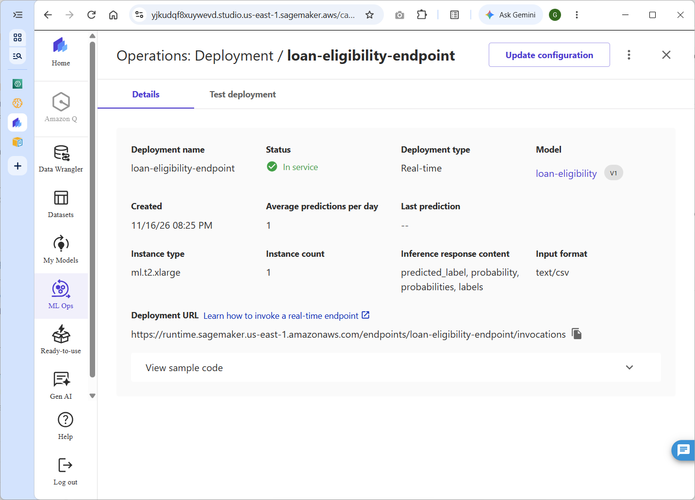
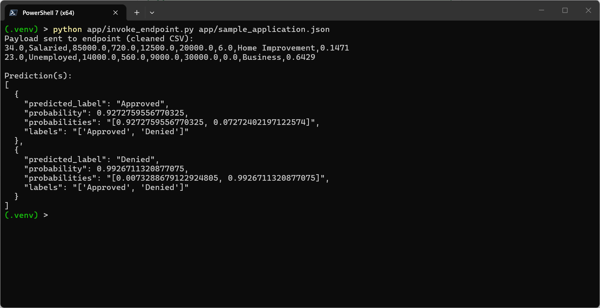

# 4. Deploy as an endpoint and use it from another application

**Time:** 10–20 minutes to deploy, 30–60 minutes for the API integration

> ⚠️ A real-time endpoint is billed per instance-hour **for as long as it exists**,
> even with zero traffic. Delete it when you're done (section 4.7).

## 4.1 Deploy from Canvas

1. In Canvas open **My models →** `loan-eligibility` and select the version to deploy.
2. Choose **Deploy** (or go to **ML Ops → Deployments → Create deployment**).
3. **Deployment name:** `loan-eligibility-endpoint`
   This becomes the SageMaker endpoint name your code will call.
4. **Instance type / count:** keep the defaults Canvas suggests (1 instance is plenty).
5. Choose **Deploy** and wait until the status is **In service** (several minutes).

If you see an instance quota error, request a quota increase for that instance
type in **Service Quotas**, or pick another suggested type.



## 4.2 Test inside Canvas

1. **ML Ops → Deployments →** `loan-eligibility-endpoint` **→ Test deployment**.
2. Edit the **Value** fields and choose **Update**.

The response contains:

| Field | Meaning |
|---|---|
| `predicted_label` | `Approved` or `Denied` |
| `probability` | confidence in the predicted label |
| `labels` | all possible labels |
| `probabilities` | probability for each label, same order as `labels` |

**Important:** note the **order of the fields** on this page. The endpoint takes
a header-less CSV row with the features in exactly that order. Compare it with
`FEATURE_ORDER` in [`app/preprocess.py`](../app/preprocess.py) and update the
list if it differs.

## 4.3 Call the endpoint from your machine

Your AWS credentials need `sagemaker:InvokeEndpoint` on the endpoint
(see [`app/iam_invoke_policy.json`](../app/iam_invoke_policy.json)).

```bash
export AWS_REGION=us-east-1
export ENDPOINT_NAME=loan-eligibility-endpoint
python app/invoke_endpoint.py app/sample_application.json
```

The script:
1. takes raw, messy applications (`"$85,000"`, `"12.5k"`, `"salaried "` …),
2. runs the **same** Canvas transform files on them,
3. builds the CSV payload in the right column order,
4. calls `invoke_endpoint` with `ContentType="text/csv"` and `Accept="application/json"`,
5. prints the cleaned payload and the prediction.

Example payload produced from the first sample application:

```
34.0,Salaried,85000.0,720.0,12500.0,20000.0,6.0,Home Improvement,0.1471
```

Output for the two sample applications: the first is Approved (92.7%), the
second is Denied (99.3%).



## 4.4 Expose it to your loan application (API Gateway + Lambda)

Your other application shouldn't hold AWS credentials or know about the CSV
format. Put a small API in front of the endpoint:

```
Loan app ──HTTPS POST /predict──► API Gateway ──► Lambda ──invoke_endpoint──► SageMaker endpoint
           (raw JSON)                              (clean + format)
```

### Package the Lambda

```bash
mkdir -p lambda_package
cp app/lambda_function.py app/preprocess.py lambda_package/
cp -r canvas_transforms lambda_package/
cd lambda_package && zip -r ../loan_lambda.zip . && cd ..
```

### Create the execution role

1. IAM → **Roles → Create role →** trusted entity **Lambda**.
2. Attach **AWSLambdaBasicExecutionRole** (CloudWatch logs).
3. Add an inline policy from `app/iam_invoke_policy.json`, replacing `REGION`
   and `ACCOUNT_ID`.

### Create the function

1. Lambda → **Create function**, runtime **Python 3.12**, use the role above.
2. Upload `loan_lambda.zip`. Handler: `lambda_function.lambda_handler`.
3. **Layers → Add a layer → AWS layers →** the AWS-managed **AWS SDK for pandas**
   layer matching your Python version (provides pandas and numpy).
4. **Configuration → Environment variables:** `ENDPOINT_NAME = loan-eligibility-endpoint`
5. **General configuration:** memory 512 MB, timeout 30 s.
6. Test with this event:

```json
{"body": "{\"age\": \"34\", \"employment_status\": \"Salaried\", \"annual_income\": \"$85,000\", \"credit_score\": \"720\", \"existing_debt\": \"12.5k\", \"loan_amount\": \"20K\", \"employment_length\": \"5 years\", \"loan_purpose\": \"Home Improvement\"}"}
```

### Create the API

1. API Gateway → **Create API → HTTP API**.
2. Add a **Lambda integration** pointing to the function.
3. Route: `POST /predict`. Stage: `$default` with auto-deploy.
4. Copy the **Invoke URL**.

### Call it from anywhere

```bash
curl -X POST "https://<api-id>.execute-api.<region>.amazonaws.com/predict" \
  -H "Content-Type: application/json" \
  -d '{"age":"34","employment_status":"Salaried","annual_income":"$85,000",
       "credit_score":"720","existing_debt":"12.5k","loan_amount":"20K",
       "employment_length":"5 years","loan_purpose":"Home Improvement"}'
```

Response:

```json
{"decision": "Approved", "probability": 0.87, "details": {...}}
```

(The probability shown is illustrative.)

### Harden it before real use
- Add authentication to the route (IAM auth, a JWT authorizer, or API keys with a usage plan).
- Add throttling on the stage.
- Validate the request body and reject unknown fields.
- Log the request ID and decision, not the applicant's personal data.

📸 *Screenshot: a successful curl or Postman call.*

## 4.5 Monitor

- **CloudWatch → Metrics → SageMaker → Endpoint:** `Invocations`, `ModelLatency`, `Invocation5XXErrors`.
- **CloudWatch Logs:** `/aws/lambda/<function-name>` for the API layer.

## 4.6 Update the model later

Train a new version in Canvas, then in **ML Ops → Deployments** edit the
deployment and select the new version. The endpoint name stays the same, so
the Lambda and your app don't change.

## 4.7 Clean up (do not skip)

1. **Canvas → ML Ops → Deployments →** delete `loan-eligibility-endpoint`.
2. Confirm in the **SageMaker AI console → Inference → Endpoints** that it's gone.
3. Delete the API Gateway API and the Lambda function if you no longer need them.
4. **Log out of Canvas.**
5. Optional: delete the Canvas datasets/models, the S3 objects Canvas created,
   and the SageMaker domain.
